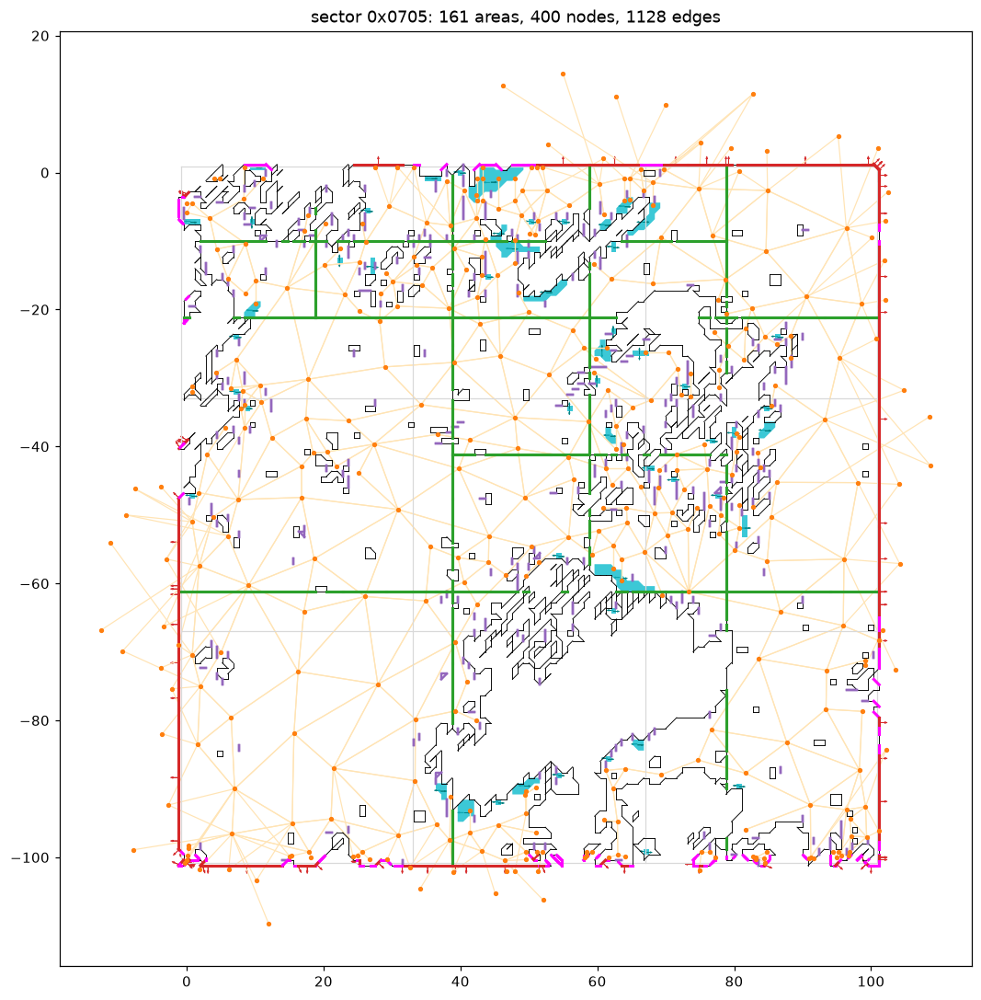

# Kynapse navigation data in Battlefield: Bad Company 2 – specification (work in progress)

Interoperability specification written from reverse engineering (see `..\README.md` for the
clean-room rules). Sources: the user's own game files (`Output\win32\ai\levels\<level>\{infantry,
vehicle}\pathdata.hpd`, 25 campaign files; byte-identical on Xbox 360), Napisal's MP files, and the
behaviour of the generator code in BFBC2Game.exe build 795745 (Project OPFOR
`research\BFBC2_DECOMP_RESEARCH.md` §9). Status: 2026-10-14, first survey.

## 1. Where the data is used

- Runtime: the level's `PathfindingTypes` (`AI/Pathfinding/Infantry`, `…/Vehicles`) select the
  data; the runtime world (Kynapse mode "Minimal") loads `…/<OutputName>/PathData.hpd`
  (`OutputName` from `PathfindingType`: "Infantry", "Vehicle"). Sector origin per level:
  `Levels/<lvl>/Precomputed/{Infantry,vehicle}/SectorOffsets.dbx` (`XOffset`, `ZOffset`).
- Coordinates: game world space, Y up (e.g. SP_009 spawns at y ≈ 480–585).

## 2. Build settings (inputs)

Shipped as `PathfindingSettings` / `PathfindingZoneSettings` / `PathfindingType` (values in
`BFBC2_DECOMP_RESEARCH.md` §9). Infantry: StepMax 0.28, StepLength 0.36, HoleMax 0.28, slope 40°,
Pitch 0.8, GraphAccuracy 3, NbSectors 32, EdgeRadius 0.41, EntityHeight 1.9, entity radius 0.4,
swept-sphere collision, detailed zones at Pitch 0.2. Vehicle: StepMax 0.4, HoleMax 0.75, slope
25–40°, Pitch 1, GraphAccuracy 15, NbSectors 64, EdgeRadius 2.51, EntityHeight 4, radius 2.5,
cylinder collision.

## 3. Build pipeline – behaviour of the original generator

Behavioural description for a re-implementation. Sources: the stage names, settings and engine
callbacks seen in BFBC2Game.exe (Project OPFOR `research\BFBC2_DECOMP_RESEARCH.md` §9), the partial
run of the original tool on SP_009 (stages 1–2 completed), and rules measured on the output (all
campaign files; "measured" = verified statistically, "inferred" = consistent with the data but not
proven).

### 3.1 Inputs

- **The loaded level's collision world.** The tool never reads source assets; it asks the running
  engine's physics world (Havok) through five callbacks:
  - point query – is a position inside geometry / where is the ground (`FUN_00EFE7F0`),
  - ray cast from a point along a direction for a length – hit position and normal (`FUN_00EFE840`;
    used for ground height and obstacle edges),
  - capsule query with the entity radius and height – does a standing agent fit here
    (`FUN_00EFE920`, collision model `PCMSweptSphere` for infantry),
  - box query – the alternative volume test (`FUN_00EFE980`, used with `UseBoxApproximation`),
  - exclusion / forbidden-volume predicates supplied by the level (`ForbidPathfinding`,
    `ExcludeFromPathfinding`, water below `WaterLevelAdjustment`, `ForbidHeight`).
- **Settings** per pathfinding type (`AI/Pathfinding/Infantry`, `…/Vehicles`): pitch, step and hole
  limits, slopes, entity radius and height, edge radius, graph accuracy, number of sectors, detailed
  zones (finer pitch), `DistEdgeMax`.
- **Seed points** (walkable start positions, plus automatic seeding).

### 3.2 Stages

| # | Stage (original name) | Behaviour | Output |
|---|---|---|---|
| 1 | Dividing sectors | Split the level's bounds into a grid of **100 m sectors**, id = `0xXXYY` (grid x, y). Each sector covers 100 m plus a margin: one pitch on the near side and 1.1 × pitch on the far side (101.68 m for infantry); sectors at the level edge drop the near margin (measured). Detailed zones (`DetailedZoneSettings`) get their own pitch (0.2) and 6 × 6 tiles. | `Sectors.xml` |
| 2 | Generating seeds | Collect seed points (given + automatic: `AutoSeedStep` probes the ground with point queries). Sectors without a seed are written empty ("No seed found, write empty pathdata"). | `sector_<n>.autoseed` |
| 3 | Generating maps (per sector) | Sample the ground on a **regular grid with spacing = pitch at whole multiples of the pitch in world space** (the rectangle's minX = sector edge − pitch is one) – outlines then run **halfway between samples**, at (k + 0.5)·pitch (measured: every outline vertex; a re-rasterisation of DICE's areas at these sample points reproduces them 100 %). A cell is walkable when the ground is found, the slope is within `GroundSlopeMin/Max`, a capsule of the entity radius and height fits, and it is not forbidden/excluded/water (inferred from settings and callbacks). Flood-fill from the seeds over neighbouring cells whose height difference is within `StepMax` (inferred), so unreachable ground is dropped. | `.aim`, `.udg` (grid maps) |
| 4 | Linking meshes | Trace the **outlines** of walkable regions halfway between samples (stair-stepped contours, holes for obstacles – measured). Split each sector into **tiles** (3 × 3; 6 × 6 in detailed zones) and cut regions further on a fixed grid **every 25 cells** (lines at minX + (25k + 24.5)·pitch: 20 m for infantry, 25 m vehicle, 5 m detailed – measured), giving **areas**. Shared cut segments become **portals** (B) to the neighbouring area; segments on the sector border become **border portals** (C) with an outward direction, listed per neighbouring sector/tile/area in the link table. Height breaks along obstacle edges become D lines and F cells (inferred). | `.pdl`, `.fdl` |
| 5 | Linking graphs | Build the high-level **graph**: nodes mostly within ~1 m of outline corners (obstacle corners offset by roughly the entity radius – measured: ~75 % infantry / ~60 % vehicle nodes), plus nodes in open ground; edges between mutually reachable nodes up to about `DistEdgeMax` (median 6 m; 99 % < 17.6 m infantry, < 48 m vehicle – measured), cost = floor(3-D length × 16). Nodes on sector borders are shared with the neighbouring sector (same id and position, high bit). | `.fsg` |
| 6 | Building hierarchical database | Assemble per-sector blocks (graph + runtime mesh), sort the node lookup lists by x, y, z, write the sector table with build timestamps. | `pathdata.hpd` |

### 3.3 Walkability measured against the engine (NavKit sampling, sp_01)

OPFOR's `[dev] navsample` option sampled a 200 × 200 m block of sp_01 (sectors 0x908–0xA09, 63,001
samples at 0.8 m) through the engine's own ray cast and capsule queries; `navkit	ools
avsample.py`
compared the result with DICE's `pathdata.hpd` (39,379 walkable reference cells):

- **Slope rule:** walkable when the hit surface's normal is within `GroundSlopeMax` (40°) of vertical.
  DICE's walkable share drops sharply at exactly that angle (78 % at 35–40°, 22 % at 40–45°);
  neighbour height differences or smoothed normals match worse. The sphere-cast radius (0.05 or
  0.001) makes no difference.
- **Geometry is complete:** flat samples two or more samples away from a non-walkable one match
  97–100 %, so the engine queries see all collision relevant to the original.
- **Residual:** with normal ≤ 40° and the soldier capsule (r 0.4 from StepMax 0.28 to 1.9 m), 90.7 % of
  the reference is found and 17.3 % extra is marked. Practically all disagreement lies within one
  sample of a walkable edge – the original decides edge cells by a finer rule not identified yet.
- A ray cast that starts inside geometry (under terrain, inside a slab) reports an immediate hit;
  the sampler steps down through solid geometry (0.5 m steps, up to 10 m) to find lower storeys.

The original tool's map-building step (stage 3) is licence-protected (section 5); NavKit implements
these stages independently.

## 4. `pathdata.hpd`

All values little-endian. **Verified** by `tools\hpdtool.py roundtrip`: all 74 `.hpd` files of the
base game and Napisal's install are parsed and written back byte for byte (2026-10-14).

### 4.1 File layout

| Offset | Size | Content |
|---|---|---|
| 0x00 | 12 | `"Kynogon HPD\0"` |
| 0x0C | 36 × u32 | header words: `2, 2, <sector count>, 1, 0,0,0,0, 2, 0, 8, 0 … 0, 36, 12, 1, 0` – identical in every file except the count |
| 0x9C | count × 48 | sector table |
| 0x9C + count×48 | Σ sizes | sector blocks, contiguous, in table order; they end exactly at the end of the file |

### 4.2 Sector table entry (48 bytes: `<I6f5I`)

| Field | Meaning |
|---|---|
| u32 id | sector grid coordinates `0xXXYY` (0x0101, 0x0102, 0x0201 … = decimal 257, 258, 513 – the original generator's `sector_<n>` file names) |
| 6 × f32 | bounds **minX, maxX, minY, maxY, minZ, maxZ** (world space, Y up) |
| u32 | 0 in every file |
| u32 size | block size in bytes |
| u32 offset | block offset from the start of the block area (running sum of the previous sizes) |
| u32 date | build date `YYMMDD` with **zero-based month**: campaign files `100007`–`100012` = January 2010; Napisal's Onslaught files `100330`/`100404`/`100407` = April–May 2010 (built by DICE before the June 2010 Onslaught release) |
| u32 time | build time `HHMMSScc` (e.g. `13305600` = 13:30:56.00) |

### 4.3 Sector block

| Part | Layout |
|---|---|
| counts | u32 node count, u32 edge count |
| nodes | node count × 36 bytes `<I3fIf3I>` – see 4.3.1 |
| edges | edge count × 12 bytes `<3I>`: cost, source node index, target node index – see 4.3.1 |
| runtime mesh | the rest of the block, starting with `"KynogonRuntimeMesh"` |

Sizes: SP_005 infantry has 269 sectors, 69 095 nodes, 199 572 edges and 18.4 MB of runtime mesh.

#### 4.3.1 High-level graph (verified statistically over all 2 776 campaign sectors)

| Node field | Meaning | Evidence |
|---|---|---|
| u32 id | node id, unique per sector; **high bit = border node shared with a neighbouring sector** | every high-bit node's id appears in a neighbouring sector at exactly the same position (84 688 / 84 688) |
| 3 × f32 | world position | inside the sector bounds |
| u32 flags | always `0x80000000` | 537 707 / 537 707 |
| f32 value | **DistEdgeMax** on the first node of each sector (infantry 15, vehicle 50 – the `PathfindingType` value), 0 elsewhere | 534 931 zeros, 2 391 × 15, 385 × 50 |
| u32 a | index of the node's first outgoing edge **+ 1** | 2 776 / 2 776 sectors |
| u32 b | low u16: k-th entry of the node indices **sorted by x**; high u16: sorted by **y** (spatial lookup lists stored interleaved, one entry per node slot) | 93 % / 98.7 % exact, the rest are ties |
| u32 c | low u16: k-th entry of the node indices **sorted by z**; **bit 16 set on border nodes** | 92.8 % exact (ties); bit 16 on exactly the 30 351 border nodes of the sample |

Edges: **sorted by source node**; cost = `0x80000000 | floor(3-D distance × 16)` (1 521 636 of
1 521 644 edges exact; the rest differ by float rounding); pairs usually exist in both directions.
Open for exactness: the tie-break order of the three sorted lists.

### 4.4 Runtime mesh record – structure (complete)

**Verified:** `tools\hpdtool.py coverage` explains every byte of all 7 944 runtime meshes in the base
game and Napisal's files (no gaps, no overlaps). The record is a relocatable memory image: all
offsets are relative to the start of the record (the marker), and **-1 means null**. The game's
loader turns offsets into pointers in place (the relocation walk defines which fields are offsets).

**Header (0x50 bytes):**

| Off | Type | Content |
|---|---|---|
| 0x00 | char[20] | `"KynogonRuntimeMesh"` + 2 zero bytes |
| 0x14 | u16 | version 2 |
| 0x16 | u16 | flags (0 in files; the loader sets bit 0) |
| 0x18 | u32 | 0 in files (the loader stores the record address) |
| 0x1C | u32 | sector id |
| 0x20 | f32 | resolution: 0.02 vehicle, 0.025 infantry, 0.05 detailed zone |
| 0x24 | f32 | **Pitch** (1.0 vehicle, 0.8 infantry, 0.2 detailed zone) |
| 0x28 | 4 × f32 | sector grid cell **minX, maxX, minZ, maxZ** – cells are 100 m; the far sides extend by 1.1 × pitch, inner near sides start one pitch early (e.g. infantry 0x0102: z −0.8 … 100.88) |
| 0x38 | u32 | tiles across X (3; 6 in detailed zones) |
| 0x3C | u32 | tiles across Z (3; 6) |
| 0x40 | f32 | entity radius (2.5 vehicle, 0.4 infantry) |
| 0x44 | u32 | offset of the tile table (always 0x50) |
| 0x48 | u32 | number of neighbour-link entries |
| 0x4C | u32 | offset of the neighbour-link table (−1 if none) |

**Tile table** at 0x50: tilesX × tilesZ + 1 offsets. The last entry points at a 4-byte slot that the
loader never reads (DICE's tool left uninitialised memory there – keep for exact copies, write 0).

**Tile:** u32 item count n; if n > 0: n × {u32 object offset, f32, f32 (min/max height of the
object)} followed by u32 end offset (end of this tile's data). An empty tile is just the count.

**Mesh object** (referenced from tiles): 0x50-byte header – u32 sector id (renumbered by the loader
if the record's id changes), …, f32 entity radius (+0x10), f32 pitch (+0x14), f32 max height
(+0x18), f32 min height (+0x1C), then pairs {u32 count, u32 offset (relative to the object, −1 if
none)} at +0x20 (A), +0x28 (B), +0x30 (C), +0x38 (D), +0x40 (E), +0x48 (F). Data follows the
header contiguously:
- A: count × 0x20-byte records (offset field at +0x18)
- B: count × 0x20-byte records – two 3-D points (a segment) and an offset at +0x18
- C: count × 0x2C-byte records (offset field at +0x18)
- D, E: an index table of count + 1 u32 (offsets relative to the object) then variable-length data
  (E holds point lists – polylines)
- F: (count + 1) × 16-byte table then variable-length data
Semantics of A–F: in progress.

**Neighbour links:** table of 12-byte entries {u32 neighbour sector id, u32 count, u32 offset of a
list}; each list holds `count` offsets of link objects; a link object has u32 count at +0x0C followed
by that many u32 offsets at +0x10.

**Trailer:** the last 8 bytes are {u32 own offset, u32 0}.

### 4.5 Semantics (from statistics over all files and plots made with `tools\hpdview.py`)

- **Mesh object = one walkable area inside one tile.** Object header +0x04/+0x08 = the tile's
  x/z index in the sector (0–2, or 0–5 in detailed zones), +0x0C = 0 (possibly a layer index),
  +0x10 entity radius, +0x14 pitch, +0x18/+0x1C max/min height of the area.
- **A:** never used (count 0 in all 171 354 objects).
- **E: the area outline** – line segments (each list holds 2 points = 24 bytes in the samples) on the
  pitch grid, giving stair-stepped contours, including closed outlines of holes (obstacles). The
  original generator samples the ground on a regular grid with spacing = pitch and traces contours.
- **Areas are a decomposition of the walkable ground** into pieces of roughly 20 m (split along tile
  boundaries and further straight cut lines); black outlines in the plot enclose the non-walkable
  parts (obstacles), the open space is walkable.

- **B: portals between areas of the same sector** – a segment (two 3-D points) on the shared
  border; +0x18 = offset of the area object on the other side (always another object of the same
  record); **+0x1C = size in bytes of that target object** (37 132 / 37 132).
- **C: portals on the sector border** – a segment on the sector's outer edge (on the 1.1 × pitch
  margin), +0x18 / +0x1C null in files (set at runtime when the neighbouring sector is loaded),
  then a unit **direction vector** (+0x20) pointing out of the sector (±x, ±z, diagonals); some have
  direction "up" (0, 1, 0) – these sit where the outline meets the border, meaning open.
- **D:** short polylines (mostly 2 points, up to 6) at obstacle edges; present in 21 % of areas.
- **F: special grid cells** – closed polygons (5–8 points) of pitch-sized cells with a height per
  corner; each row holds a horizontal direction (±x, ±z, diagonals); at obstacle edges, present in
  6 % of areas – likely ledges / height breaks with their direction.
- D and F are detail features: a generator can start without them (counts 0) and still produce
  valid data.
- **Graph:** see 4.3.1.

Open: exact meaning of D, F and the "up" C portals.

### 4.6 Structured round trip and writing conventions

**Verified:** `tools\kymesh.py` parses every runtime mesh into areas, portals, outlines, cells and
links, and `write_mesh` lays the record out again, recomputing every offset and size – **7 944 / 7 944
meshes byte-identical** (`hpdtool.py meshtrip`, base game + Napisal). Layout order used by DICE's
tool (and by the writer):

1. header (0x50), tile table ((tilesX × tilesZ + 1) × 4)
2. for each tile in table order: the tile record, then every area object it references for the first
   time
3. the 4-byte end slot (last tile-table entry points here)
4. neighbour-link table, then for each entry: its list of link-object offsets followed by the link
   objects
5. trailer {own offset, 0}

Conventions observed in all DICE files (what a generator writes):

| Item | Rule |
|---|---|
| empty lists (count 0) | offset field = `0xFFFFFFFF` |
| no neighbour links | link offset `0xFFFFFFFF` |
| version / flags / loaded | 2 / 0 / 0 |
| tile table order | column-major: entry t = tile (x = t / tilesZ, z = t mod tilesZ) |
| tile item floats | the area's (min height, max height) |
| area +0x00 / +0x10 / +0x14 | = record sector id / entity radius / pitch |
| area +0x04 / +0x08 | tile x / tile z |
| area +0x0C | **index of the area within its tile** (0, 1, 2 …) |
| B +0x18 / +0x1C | target area offset / target area size |
| C +0x18 / +0x1C | `0xFFFFFFFF` (runtime) |
| F terminating row | offset of the data end, direction (0, 0, 0) |
| link object | header {neighbour tile x, neighbour tile z, area index in that tile} (83 % match the mirrored tile; the rest are neighbours with a different tile grid – to confirm), count, offsets of this sector's C records leading there |
| end slot | 4 bytes, never read – write 0 |

## 5. Licence boundary

The original generator's map-building step (`Kaim::CMapBuilder`) requests a FLEXnet licence for the
feature "CMapBuilder" (registry `HKLM\SOFTWARE\FLEXlm License Manager`, licence path `.\*.lic`). This
is documented only as the boundary; NavKit does not use or bypass it and runs no Kynapse code.
